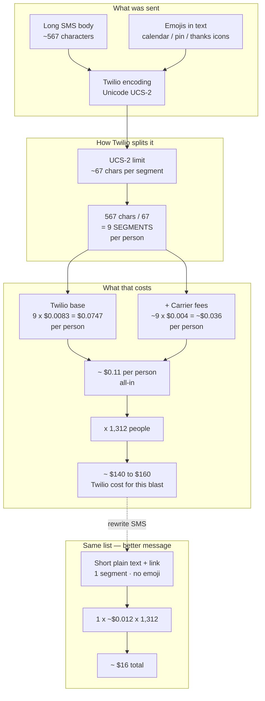
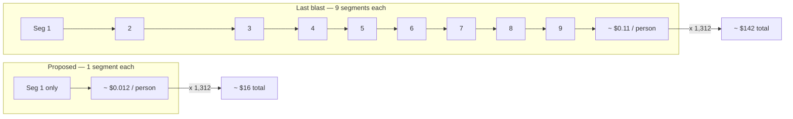

# Proposal: Cut Broadcast SMS Cost (Template + Guardrails)

**Audience:** Platform owner  
**Status:** Ready for decision  
**Evidence:** Career Introduction blast `#90001` + Twilio Message Segment Calculator + live Twilio Message prices  
**Related:** `docs/BROADCAST_SMS_COST_OWNER_BRIEF.md` · `docs/TWILIO_BULK_MESSAGING_BROADCAST_PROPOSAL.md`

---

## 1. Why the last broadcast cost a lot (diagram)

Campaign: **Career Introduction** (`#90001`) · **1,312** SMS sent · Calculator: **UCS-2 · 9 segments · 567 chars** · Twilio Message price **$0.07470**/person.



### Per-person cost stack



**One-liner:** Send once ≠ pay once. Twilio billed **9 segments × 1,312 phones** because emojis forced UCS-2 on a long flyer SMS.

---

## 2. Problem (proven)

Last major SMS blast (**Career Introduction**, 1,312 sent) used a long body **with emojis**.

Twilio Message Segment Calculator (same text):

| Result | Value |
|--------|--------|
| Encoding | **Unicode (UCS-2)** |
| Segments | **9** |
| Characters | **567** |

Twilio live Message records for that campaign:

| Field | Value |
|--------|--------|
| `numSegments` | **9** |
| `price` (Twilio base) | **$0.07470** each (`9 × $0.0083`) |
| Est. Twilio base for 1,312 | **~$98** |
| Est. all-in (+ carrier fees) | **~$140–$160** |

**Root cause:** Not the CRM UI and not “Twilio being uniquely expensive.”  
**Cost = recipients × segments × (~$0.0083 + carrier fee).**  
Emojis forced UCS-2 (~67 chars/segment) → **9 segments per person**.

Twilio Bulk Messaging does **not** fix this (same $/segment).

---

## 3. Proposal (what we recommend)

### A. Owner policy (do now — $0 product work)

**Broadcast SMS policy:**

1. **Max 1 segment preferred; hard max 2 segments** for any blast.  
2. **No emojis / symbols** in SMS blasts.  
3. **Long invite content lives on a link** (Canva / landing page) — SMS is only the nudge.  
4. **Paste every draft** into [Twilio Segment Calculator](https://twiliodeved.github.io/message-segment-calculator/) before Send.  
5. Prefer **email** for full flyers; SMS for short reminders.

**Approved short template pattern:**

```text
Hi {{first_name}}, Encore Mortgage free career intro Sat Jul 25 11am Whittier. Details/RSVP: https://canva.link/career-introduction
```

Target: **GSM-7 · 1 segment · ~$0.012/person all-in**.

### B. Product guardrails (implement next — recommended)

Add in Broadcast Center compose (SMS step):

| Guardrail | Behavior |
|-----------|----------|
| Live segment estimate | Show **encoding + segment count** as they type |
| Cost estimate | `recipients × segments × $0.012` → “Est. Twilio ~$X” |
| Soft warn | Yellow if **≥ 3 segments** |
| Hard warn / confirm | Modal if **≥ 5 segments** |
| Emoji detect | Warn: “Emoji switches to UCS-2 and multiplies cost” |
| Link helper | Suggest “short SMS + details link” |

### C. What we are **not** proposing as a cost fix

| Idea | Verdict |
|------|---------|
| Twilio Bulk Messaging | **Ops/reliability only** — not a cost reducer |
| Switch to GHL for “cheaper SMS” | Same segment/carrier economics underneath |
| New “bulk discount” Billing meter | Misleading — do not create |

---

## 4. Money impact (same 1,312 people)

| Message style | Segments | Est. all-in (~$0.012/seg) | vs last blast |
|---------------|----------|---------------------------|---------------|
| **Last blast (emoji + long)** | 9 | **~$141** | baseline |
| No emoji, still long (~4 GSM-7) | ~4 | **~$63** | ~**55% less** |
| **Proposed short + link** | **1** | **~$16** | ~**89% less** |

---

## 5. Decision checklist

- [ ] Approve **1-segment (max 2) SMS blast policy**  
- [ ] Rewrite future career / event SMS to **short + link** (no emoji)  
- [ ] Approve **segment + $ estimate** in Broadcast compose  
- [ ] Keep Twilio Bulk scoped to **delivery reliability**, not cost savings  

---

## 6. One-liner for stakeholders

> **Twilio charged ~9× per person because emojis + a long flyer in SMS. Policy: short plain text + link (1 segment). Optional UI warning so this can’t happen again by accident. Bulk API won’t make Twilio cheaper.**

---

*Calculator proof: UCS-2 · 9 segments · 567 chars · same body as campaign `#90001`.*
