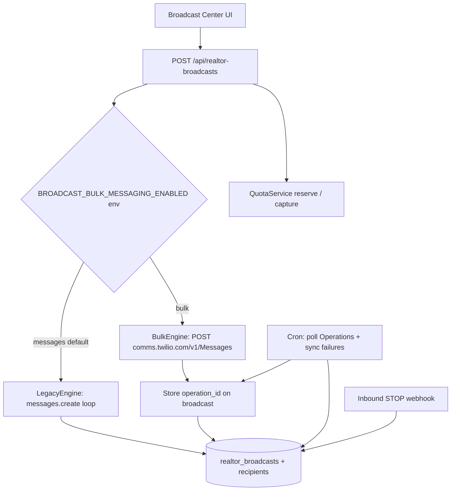

# Proposal: Twilio Bulk Messaging Engine for Realtor Broadcasts

**Status:** Implemented (Phase 0–1) — flag default OFF via env (`BROADCAST_BULK_MESSAGING_ENABLED` unset / `BROADCAST_SMS_ENGINE=messages`) — **not exposed in Settings UI**  
**Goal:** Add a **Bulk Messaging delivery engine** behind Broadcast Center for large SMS campaigns, with Operation-based progress and failure-focused recipient storage — **zero breaking changes** to existing Broadcast UX, APIs, billing, or email path.  
**Non-goal:** Reduce Twilio per-segment price (Bulk does not change SMS unit economics).  
**Owner FAQ (why blasts feel expensive vs GHL):** `docs/BROADCAST_SMS_COST_OWNER_BRIEF.md` — **Twilio-sourced** pricing, segments, carrier fees, and Bulk docs.  
**Cost-cut proposal (templates + UI guardrails):** `docs/BROADCAST_SMS_COST_REDUCTION_PROPOSAL.md`

---

## 1. Executive summary

| Today | Proposed |
|-------|----------|
| SMS: 1× `messages.create` per recipient (~1 msg/sec, Vercel batch resume) | SMS (flagged): 1× Bulk request (≤10k `to[]`), poll Operation for progress |
| Full per-recipient status for every send | Aggregate progress + **persist per-recipient primarily for failed/undelivered/opted_out** |
| Email: Resend (unchanged) | Email: Resend (unchanged) |
| Billing: `sms_segments` reserve/capture | Billing: **same** `sms_segments` meter — quota **still updates**; label as **Broadcast (Bulk)** |
| Infra (Vercel / DB / webhooks / TiDB RUs) | **Lower** for large SMS blasts |
| Monthly platform fee | **Unchanged** |

**Principle:** Dual-engine behind a feature flag. Legacy Messages API remains default until Bulk is validated in production. Rollback = flip flag off.

**Cost summary (owner-facing):**

| Cost | With this implementation |
|------|--------------------------|
| Infra (our platform ops) | Cheaper for large SMS campaigns |
| Billing quota (`sms_segments`) | **Updated** on every Bulk campaign (reserve → capture) |
| Monthly plan / platform fee | Not changed |
| Twilio $/segment | Not changed |
| New “bulk segments” price unit | **Do not create** — same SMS segments, clearer label only |

---

## 2. Why (and what this does *not* claim)

### Why build it
- Large blasts (1k+) are fragile under serverless timeouts even with batch resume.
- Thousands of Twilio HTTP round-trips amplify infra load (DB updates, webhooks, TiDB RUs).
- Twilio Bulk Operations give campaign-level progress without our 1s throttle loop.
- Aligns with Twilio [Bulk Messaging](https://www.twilio.com/docs/bulk-messaging) + [Operations tracking](https://www.twilio.com/docs/bulk-messaging/operations-and-message-tracking).

### What this does **not** do
- Does **not** lower Twilio $/segment or invent a discounted “bulk segment” Billing dimension.
- Does **not** skip or freeze quota — Bulk campaigns **still consume** `sms_segments`.
- Does **not** change the monthly platform fee.
- Does **not** replace STOP compliance, quota reserve, or Broadcast UI.
- Does **not** require users to learn a new “Bulk” product — same Broadcast Center.

---

## 3. Non-breaking contract (hard requirements)

1. **Same routes** — `POST/GET /api/realtor-broadcasts`, recipients, cancel, resend, cron — keep shapes.
2. **Same UI** — New Broadcast / History; only additive progress (Operation bar).
3. **Same billing** — `reserveBroadcastQuota` / `captureBroadcastDelivery` / `sms_segments` unchanged in meaning.
4. **Same STOP** — inbound STOP/START still updates opt-out and pending recipients.
5. **Email path untouched** — Bulk is SMS-only; `channel=email|both` email half stays Resend loop.
6. **Feature flag default OFF** — env `BROADCAST_BULK_MESSAGING_ENABLED` / `BROADCAST_SMS_ENGINE` (ops only, **no Settings UI**). Default legacy `messages`.
7. **Rollback** — set flag to `messages`; in-flight Bulk campaigns finish via Operation poller or safe cancel; no schema drop.
8. **Public Beta caveat** — Twilio Bulk is Public Beta (no SLA). Production use requires kill-switch + automatic fallback on Bulk API failure.

---

## 4. Architecture



### Dual engine interface (internal)

```ts
interface BroadcastSmsEngine {
  start(broadcastId: number): Promise<void>;
  cancel(broadcastId: number): Promise<void>;
  // Cron / resume
  tick(broadcastId: number): Promise<void>;
}
```

- `LegacySmsEngine` — current `sendBroadcastAsync` SMS path (copy as-is).
- `BulkSmsEngine` — new path below.
- Router chooses engine from env `BROADCAST_BULK_MESSAGING_ENABLED` / `BROADCAST_SMS_ENGINE` + channel + size heuristics (optional). **Not a Settings UI toggle.**

---

## 5. Bulk engine design (robust)

### 5.1 Campaign create (unchanged UX)
1. Resolve audience (existing `resolveAudience`) — SKIP opted-out, no phone, invalid.
2. Insert `realtor_broadcasts` + **all** recipient rows with `sms_status=pending` (keep audience snapshot for audit/billing).
3. Reserve quota from `recipient_count × smsSegmentsFromBody(body)` (same as today).
4. If engine = `bulk` and channel includes SMS → `BulkSmsEngine.start`.

**No breaking change:** Recipients table still exists; we do not remove rows.

### 5.2 Send (Bulk)
1. Chunk recipients into batches of **≤ 9,000** (buffer under Twilio’s 10k limit).
2. For each chunk, `POST https://comms.twilio.com/v1/Messages` with:
   - `from`: `{ address: twilio_caller_id, channel: "SMS" }` (same number as today)
   - `to[]`: `{ address, channel: "PHONE", variables: { first_name, ... } }`
   - `content`: text or Content Template with merge vars
3. Persist on broadcast (new columns):
   - `sms_engine = 'bulk'`
   - `twilio_operation_ids` JSON array of operation IDs
   - `bulk_stats_json` last polled Operation stats
4. Mark chunk recipients `sms_status = 'processing'` (or leave pending until Operation completes — prefer `processing` for lock clarity).
5. Do **not** call `messages.create` per person.

### 5.3 Progress bar (Operation poll)
Cron every **1–2 min** (or piggyback existing `process-scheduled-broadcasts`):

```http
GET https://comms.twilio.com/v1/Messages/Operations/{operationId}
```

Map Twilio stats → broadcast:

| Operation field | Our field / UI |
|-----------------|----------------|
| `stats.sent` + `delivered` | `sent_count` (live) |
| `stats.failed` + `undelivered` + `unaddressable` | `failed_count` |
| `status === COMPLETED` | finalize when all ops done |
| `queued` / `scheduled` | progress % |

UI: History row + detail drawer show **progress bar** from `bulk_stats_json` when `sms_engine=bulk`.

### 5.4 Failure-focused per-recipient persistence
When Operation completes (or periodically for failures):

1. `GET /v1/Messages?operation_id=...` (paginated).
2. For messages with terminal failure (`FAILED`, `UNDELIVERED`, unaddressable):
   - Match recipient by phone (`to.address`).
   - Set `sms_status = failed|undelivered`, `error_message`, optional Bulk `messageId` / SM SID if present in callbacks.
3. For successes: either
   - **Option A (recommended Phase 1):** bulk-update remaining `processing` → `sent` in one SQL (`WHERE broadcast_id=? AND sms_status='processing'`), **or**
   - **Option B:** leave successes as aggregate-only and set broadcast-level counts from Operation stats only.

**Recommendation Phase 1:** Option A — keeps History “77/1431” accurate without N webhook storms; failures get rich rows for retry.

### 5.5 Status callbacks (optional Phase 2)
Twilio can include `operationId` / `messageId` on status callbacks. Wire webhook to:
- Update failure rows immediately.
- Ignore or rate-limit success callbacks when using Option A.

Keep existing `/api/webhooks/sms-status` for **legacy** Message SIDs — no break.

### 5.6 Cancel
- Set `is_cancelled=1` (existing).
- Attempt Twilio Operation cancel if API supports it; otherwise stop polling new chunks and mark remaining pending as cancelled/skipped.
- Release unused reservation (existing).

### 5.7 Fallback (robustness)
If Bulk `POST` returns 4xx/5xx / auth / beta outage:
1. Log `BroadcastTrace bulk_fallback_to_legacy`.
2. Auto-switch **this campaign only** to `LegacySmsEngine`.
3. Notify platform owner: “Bulk unavailable — campaign continued with standard send.”
4. Do not flip global flag unless admin chooses.

### 5.8 Personalization
- Prefer Twilio Bulk **variables** for `{{first_name}}` etc.
- If body uses tags Bulk can’t express, either reject Bulk for that campaign or fall back to legacy (document in UI when flag on).

### 5.9 MPS / compliance
Twilio: “existing MPS limits still apply.” Keep A2P 10DLC registration; do not assume Bulk bypasses throughput. Chunk + Operation async absorbs our serverless limit; Twilio still throttles delivery.

---

## 6. Schema (additive only)

Migration (new file under `database/migrations/`):

```sql
ALTER TABLE realtor_broadcasts
  ADD COLUMN sms_engine ENUM('messages','bulk') NOT NULL DEFAULT 'messages'
    AFTER channel,
  ADD COLUMN twilio_operation_ids JSON NULL
    AFTER sms_engine,
  ADD COLUMN bulk_stats_json JSON NULL
    AFTER twilio_operation_ids;

-- Optional: store Bulk message id separately without breaking sms_ext_id consumers
ALTER TABLE realtor_broadcast_recipients
  ADD COLUMN sms_bulk_message_id VARCHAR(128) NULL
    AFTER sms_ext_id;
```

Settings (no migration required if upsert via API):

| Key | Values | Default |
|-----|--------|---------|
| `BROADCAST_BULK_MESSAGING_ENABLED` | `0` / unset / `1` | unset (off) — **env only, no Settings UI** |
| `BROADCAST_SMS_ENGINE` | `messages` \| `bulk` | unset → follow ENABLED flag |
| `broadcast_bulk_min_recipients` | int | `200` (optional: only use Bulk above N) |
| `broadcast_bulk_chunk_size` | int | `9000` |

Update `database/schema.sql` after migration apply.

---

## 7. API / UI (additive)

### API
- List/get broadcast responses add optional: `sms_engine`, `bulk_stats`, `progress_pct`.
- No required client changes for old UI.
- Cron: extend `process-scheduled-broadcasts` → also `pollBulkBroadcastOperations` (≤10 ops/tick).

### UI
- History: if `sms_engine=bulk`, show progress bar from Operation stats (sent/failed/total).
- Detail: “Failures only” filter default for Bulk campaigns; full list still available (pending→sent rows exist under Option A).
- Settings (platform owner): toggle “SMS delivery engine: Standard | Bulk (beta)”.
- Billing (see §8.2): show **Broadcast (Bulk)** as a label on usage/ledger breakdown — not a new meter.

### Swagger
Document new response fields + setting keys. No removed fields.

---

## 8. Billing, quota, and infra economics

### 8.1 What changes vs what stays the same

| Item | Behavior after Bulk |
|------|---------------------|
| **Infra** (Vercel invocations, per-recipient DB/status writes, webhook volume, TiDB RUs) | **Cheaper** for large SMS blasts — primary savings of this project |
| **Monthly platform fee** | **Unchanged** |
| **Billing quota dimension** | Still **`sms_segments`** (unified pool with conversational SMS) |
| **Quota updates** | **Yes** — Bulk campaigns reserve before send and capture on finalize |
| **Twilio message cost** | Same per-segment / carrier fees for the same audience + body |
| **New Billing product “bulk_segments”** | **Out of scope / forbidden** — would falsely imply a different unit price |

### 8.2 Quota lifecycle (must stay wired)

```text
Create Bulk campaign
  → reserve sms_segments (recipients × segments_per_body)
  → Twilio Bulk delivers
  → poll Operation → progress bar
  → capture actual sent/delivered segments
  → release unused reservation
  → Live quota + Expended UI refresh
```

Same helpers as today: `reserveBroadcastQuota`, `captureBroadcastDelivery`, `releaseBroadcastReservation`.  
Ledger `source` remains `broadcast` (optionally metadata `engine: "bulk"` for filtering — not a new dimension).

### 8.3 Billing UI labeling (required in implementation)

Do **not** add a separate cheaper meter. Keep one pool; explain delivery engine in copy:

```text
SMS segments (unified pool)
  ├─ Conversational
  └─ Broadcast
        └─ engine: Bulk   ← label only
```

**Example owner-facing copy:**

> **Broadcast SMS — 2,862 segments**  
> Campaign “Career Introduction” · delivery engine: **Bulk**  
> Counts toward your monthly SMS quota (same rate as standard broadcast).

**Live quota / Expended:**
- Continue showing Broadcast SMS share of `sms_segments`.
- When `sms_engine=bulk`, badge or subtitle: **Bulk**.
- Tooltip: “Bulk is a delivery method. Segments are billed the same as standard SMS broadcast.”

### 8.4 Metering steps (implementation table)

| Step | Behavior |
|------|----------|
| Reserve | Before send: estimated segments × recipients (same helper) |
| Capture | On finalize: capture **actual** delivered/sent segments; release remainder |
| Actual | Prefer Operation delivery counts × body segments; reconcile with Twilio usage if needed |
| Display | Expended / Live quota still `sms_segments`; label **Broadcast (Bulk)** when applicable |
| Monthly fee | No change to `platform_fee_usd` / Stripe subscription price |

### 8.5 Explicit non-goals for Billing

- No `bulk_segments` usage dimension in `tenant_usage_period`.
- No separate overage rate for Bulk.
- No “Bulk campaigns don’t count toward quota” behavior.
- No change to included SMS allotment solely because Bulk is enabled.

---

## 9. Phased rollout (no big bang)

### Phase 0 — Prep (1–2 days)
- Feature flag + settings UI.
- Schema columns.
- Smoke tests for router (flag off → legacy only).
- Document Twilio Bulk Public Beta risk.

### Phase 1 — Bulk engine behind flag (core)
- `BulkSmsEngine.start` + Operation poll cron.
- Progress bar on History for Bulk campaigns.
- Success bulk-update + failure row enrichment.
- Auto-fallback to legacy on Bulk API failure.
- Billing: reserve/capture still on `sms_segments`; UI label **Broadcast (Bulk)**; ledger metadata `engine=bulk` optional.
- Unit tests: chunking, phone match, stats mapping, finalize, quota capture on Bulk finalize.
- Smoke: send ≤5 test numbers with flag on (non-prod / sandbox); verify Live quota moves.

### Phase 2 — Hardening
- Status callback correlation (`operationId`).
- Resend-failed uses legacy or Bulk for failure subset only.
- Segment cost preview (separate savings workstream — recommended but not required for Bulk).

### Phase 3 — Default for large SMS only (optional)
- Auto-select Bulk when `recipient_count >= broadcast_bulk_min_recipients` and flag allows.
- Keep `messages` for small blasts / heavy personalization.

**Do not** make Bulk default until Phase 1 passes production canary (e.g. 3 platform-owner campaigns).

---

## 10. Testing & validation (mandatory)

| Layer | Cases |
|-------|--------|
| Unit | Chunk ≤9000; stats → counts; phone normalize match; cancel mid-poll; fallback trigger |
| Smoke | Flag off = identical legacy behavior; flag on = operation_id stored; progress updates; failures listed |
| Billing | Reserve before; capture ≤ reserved; no double-charge on fallback; Live quota decreases; UI shows Broadcast (Bulk); no `bulk_segments` dimension |
| STOP | STOP during Bulk campaign opts out and stops future; pending marked opted_out |
| Chaos | Kill poll mid-flight; resume cron; duplicate poll idempotent |
| Load | 1.5k recipients canary; verify no Vercel timeout on start (202 Accepted only) |
| Rollback | Flip flag; new campaigns use legacy; old Bulk ops finish cleanly |

Add: `npm run validate:broadcast-bulk` smoke script (mirror billing-period pattern). Gate deploy when enabling Bulk.

---

## 11. Risks & mitigations

| Risk | Mitigation |
|------|------------|
| Twilio Bulk Public Beta / API change | Flag + fallback; pin request/response adapters |
| Phone match fails (formatting) | Normalize E.164 before send and on sync |
| Under-count delivered | Prefer Operation stats as source of truth for totals |
| Over-capture quota | Capture from delivered+sent only; release rest |
| Lost failure detail | Always pull failed messages list before finalize |
| Email+SMS “both” | Bulk SMS + existing email loop; don’t block email on Bulk |
| Compliance | STOP + daily caps + A2P unchanged |

---

## 12. Success metrics

- Large SMS campaign (>500) completes without stuck `sending` >15 min.
- TiDB/write volume per campaign drops vs legacy (fewer status updates) — **infra cheaper**.
- Billing quota **updates** after Bulk send (`sms_segments` used/reserved consistent with campaign).
- Monthly platform fee unchanged; no new Billing dimension.
- Owner sees **Broadcast (Bulk)** label on Billing breakdown / campaign detail.
- Zero billing regressions (quota deltas match campaign size within tolerance).
- Rollback time &lt; 1 minute (settings toggle).
- Platform owner can see progress bar + failure list without opening Twilio Console.

---

## 13. Explicit out of scope (this proposal)

- RCS / WhatsApp / channel fallback (can be Phase 4 later).
- Removing recipient rows for successes entirely (audit prefers Option A).
- Changing SMS retail/COGS rates, included quota, or monthly platform fee.
- Creating a `bulk_segments` (or similar) Billing dimension / discounted rate.
- Skipping quota accounting for Bulk campaigns.
- Migrating conversational SMS / reminder-flow SMS to Bulk.
- Replacing Resend email with anything Bulk-related.

---

## 14. Recommendation

**Approve Phase 0–1** with:

1. Dual engine + flag default **OFF**.  
2. Operation poll progress bar.  
3. Failure-enriched recipients + bulk success finalize.  
4. Automatic legacy fallback.  
5. No API/UI/billing contract breaks.  
6. Infra savings + **quota still updates** on `sms_segments`; Billing shows **Broadcast (Bulk)** label; monthly fee unchanged.

Treat Bulk as a **delivery reliability + infra efficiency** upgrade — not a Twilio discount and not a new quota product.

**Implementation status (2026-07-21):** Phase 0–1 landed behind env gate `BROADCAST_BULK_MESSAGING_ENABLED` (default off; not in Settings UI). See migration `20260721_153000_broadcast_bulk_messaging_engine.sql`, `shared/broadcast-bulk.ts`, Broadcast progress Bulk badge, Billing “Broadcast (Bulk)” copy, and `npm run validate:broadcast-bulk`.

---

## 15. Approval checklist

- [ ] Platform owner accepts Public Beta risk + kill switch  
- [ ] Confirm Twilio account access to `comms.twilio.com/v1` Bulk API  
- [ ] Sender number (`twilio_caller_id`) approved for campaign SMS volume  
- [ ] Approve Phase 0–1 scope only  
- [ ] Schedule canary campaign after deploy  

---

*References:* [Twilio Bulk Messaging](https://www.twilio.com/docs/bulk-messaging) · [Getting started](https://www.twilio.com/docs/bulk-messaging/getting-started) · [Operations and message tracking](https://www.twilio.com/docs/bulk-messaging/operations-and-message-tracking) · [Channel fallback](https://www.twilio.com/docs/bulk-messaging/channel-fallback) · Internal: `docs/REALTOR_BROADCAST_PROPOSAL.md`, `sendBroadcastAsync` in `api/index.ts`
