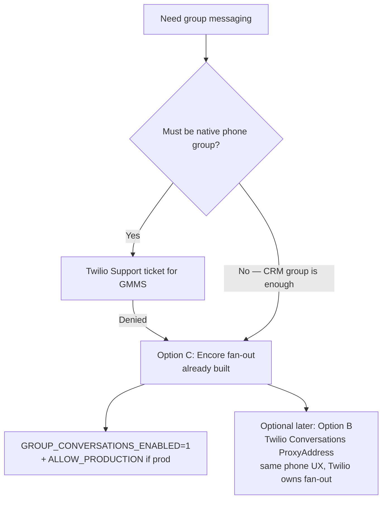

# Twilio options for group messaging (when GMMS is unavailable)

**Date:** 2026-07-23  
**Question:** Native Group MMS is closed to new use — what can we still use from Twilio for group messaging with **similar functionality**?  
**Out of scope:** Realtor Broadcast / Bulk.

---

## 1. Short answer

Twilio **does not** offer a replacement that recreates **iMessage-style native SMS Group MMS** for new accounts.

What Twilio **does** still support (and documents) is a **Conversation with multiple SMS/WhatsApp participants** where:

- The **app / Twilio Conversation** is one shared thread  
- Each phone gets a **blast-style / 1:1 SMS** from a Twilio number (**not** a carrier group chat)  
- When someone replies, Conversations (or your app) **fans that reply to the other participants**

That is the official model in [Conversations limits](https://www.twilio.com/docs/conversations-classic/conversations-limits):

> Non-chat Participants (SMS/WhatsApp) receive a **blast-type Message** from the group. An SMS participant receives messages from a **single phone number** and **won't experience the group-style Conversation**. When they respond, their message goes to **all Participants**.

**Encore already implements this pattern** (CRM group + 1 SMS per person + inbound merge). That is the viable “same functionality as GMMS” for product ops — **shared group in CRM**, not shared group bubble on every phone.

---

## 2. Twilio products compared (from docs)

| Option | Twilio product | Native phone group? | Shared thread in app? | Available on new accounts? | GMMS-like? |
|--------|----------------|---------------------|------------------------|----------------------------|------------|
| **A. Native Group MMS** | Conversations (classic) + **ProjectedAddress** | **Yes** (US/CA MMS group) | Yes | **No** — [changelog Mar 15, 2022](https://www.twilio.com/en-us/changelog/limitation-to-group-mms); [50452](https://www.twilio.com/docs/api/errors/50452) | Exact GMMS |
| **B. Multi-party Conversations (SMS)** | Conversations + **Address + ProxyAddress** per SMS user | **No** — blast from one Twilio # | **Yes** (Twilio CH…) | **Yes** | Closest SMS substitute |
| **C. Programmable Messaging fan-out** | `messages.create` loop (Encore today) | **No** | **Yes** if *you* store the group | **Yes** | Same UX as B, you own routing |
| **D. WhatsApp “group” via Conversations** | WhatsApp + Conversations ([DevEd sample](https://github.com/TwilioDevEd/whatsapp-group-messaging)) | **No** native WA group | **Yes** | **Yes** (WA sender + templates) | Similar *app* group; different channel |
| **E. Chat SDK + SMS participants** | Conversations Chat identity + SMS ProxyAddress | No on SMS side | Yes | Yes | Bankers in web chat; clients on SMS |

There is **no** documented Twilio API that re-enables ProjectedAddress GMMS for accounts that never had it.

---

## 3. Deep dive — what each option is (Twilio docs)

### A — Native Group MMS (unavailable for new use)

| Doc | Role |
|-----|------|
| [Limitation to Group MMS](https://www.twilio.com/en-us/changelog/limitation-to-group-mms) | Closed to new accounts |
| [Group Texting (classic)](https://www.twilio.com/docs/conversations-classic/group-texting) | ProjectedAddress, +1 long code, ~10 people |
| [Inbound autocreation — number group](https://www.twilio.com/docs/conversations-classic/inbound-autocreation) | Matching set of Addresses + ProjectedAddresses |
| [50452](https://www.twilio.com/docs/api/errors/50452) | GMMS not enabled |

**Phone UX:** true group thread (names in header).  
**Status:** only grandfathered accounts.

---

### B — Multi-party Conversations **without** GMMS (Twilio’s working substitute)

| Doc | Role |
|-----|------|
| [Working with Conversations (classic)](https://www.twilio.com/docs/conversations-classic/working-with-conversations) | Add non-chat participant with `proxyAddress` + `address` |
| [Inbound autocreation — number pair](https://www.twilio.com/docs/conversations-classic/inbound-autocreation) | Each SMS user = **Address + ProxyAddress** pair |
| [Conversations limits](https://www.twilio.com/docs/conversations-classic/conversations-limits) | Up to **50** SMS/WhatsApp participants; they get **blast-type** messages |
| Participant resource | Same person can be in many Conversations if **ProxyAddress differs** per Conversation |

**How it works (Twilio):**

1. Create a Conversation  
2. Add banker as Chat `identity` (optional)  
3. For each mobile user: `MessagingBinding.Address` = their phone, `MessagingBinding.ProxyAddress` = Twilio number  
4. Message in Conversation → Twilio fans out SMS to each binding  
5. Inbound SMS to that proxy pair → lands in the Conversation → fans to others  

**Phone UX:** each client sees a **normal 1:1 SMS** with the business number (not “Group MMS”).  
**CRM UX:** one Conversation SID / one Encore group thread.

**Critical:** Do **not** use `ProjectedAddress` unless GMMS is enabled — that triggers **50452**.

Community confirmation: [SO — avoid ProjectedAddress; use ProxyAddress](https://stackoverflow.com/questions/75416467/conversation-adding-second-phone-number-error-group-mms-is-not-enabled).

---

### C — Programmable Messaging fan-out (Encore current)

| Doc | Role |
|-----|------|
| [Programmable Messaging](https://www.twilio.com/docs/messaging) | `messages.create({ to, from, body })` per recipient |
| Note in inbound GMMS guide | **Programmable Messaging does not support Group MMS** |

**How it works:** Same blast semantics as B, but **Encore** owns participant list, fan-out, and reply merge (`processInboundGroupIndividualReply`).

**Why keep it:** Already built, no Conversations SID migration, works with existing inbound SMS webhook.

---

### D — WhatsApp group-like (Twilio Conversations)

| Doc / sample | Role |
|--------------|------|
| [Using WhatsApp with Conversations (classic)](https://www.twilio.com/docs/conversations-classic/using-whatsapp-conversations) | WA as non-chat channel |
| [TwilioDevEd whatsapp-group-messaging](https://github.com/TwilioDevEd/whatsapp-group-messaging) | Multi-participant WA via Conversations |

Twilio’s own sample maintainers clarify: **not** native WhatsApp groups — individual WA messages that *feel* like a group in the app ([SO](https://stackoverflow.com/questions/78349347/has-anyone-been-successful-in-sending-group-messaging-on-whatsapp-using-twilio)).

**Fit:** only if clients are on WhatsApp Business and opt-in/templates are acceptable. Different compliance and UX than realtor SMS.

---

### E — Chat in browser + SMS clients

Bankers use Conversations Chat SDK; clients stay on SMS via ProxyAddress (same as B).  
Improves **agent** UX; does not create phone-native groups.

---

## 4. Functionality matrix vs GMMS goals

| Goal (from this chat) | GMMS (A) | Conversations Proxy (B) | Encore fan-out (C) | WhatsApp (D) |
|-----------------------|----------|-------------------------|-------------------|--------------|
| One thread in Encore | Yes | Yes | **Yes (today)** | Yes |
| All members see each other’s messages (via app/routing) | Yes | Yes | **Yes** | Yes |
| Same bubble on every phone | **Yes** | No | No | No |
| Works on US 10DLC | Broken / frozen | Yes | **Yes** | N/A (WA) |
| Enable without Twilio Support exception | No | Yes | **Yes** | WA setup |
| Max ~10 native MMS | Yes | Up to 50 SMS blast | Soft limit in app | Up to 50 non-chat |

**“Same functionality as GMMS” for business (mortgage banker + clients):**  
→ Shared group + everyone gets the messages + replies visible to the group  
→ **B or C** (Encore already = C)

**“Same as iMessage group on the lock screen”:**  
→ **Only A**, and A is unavailable for new use.

---

## 5. Recommended option for Encore

### Primary recommendation: **Option C (keep / enable Encore groups)**

- Matches Twilio’s documented **blast-type** multi-SMS Conversation behavior  
- No dependency on frozen GMMS  
- Enable with env flags (see `docs/GROUP_CONVERSATIONS.md`)

### Optional upgrade: **Option B (Twilio Conversations ProxyAddress)**

Use if you want Twilio to store Conversation state / fan-out instead of Encore loops.

**Pros:** Twilio webhooks `onMessageAdded`, SDK chat for bankers  
**Cons:** ProxyAddress uniqueness rules, migration off current webhook model, still **not** native phone groups  

### Do not promise: **Option A** unless Support enables GMMS on Account SID.

### Consider later: **Option D** only for WhatsApp-first clients.

---

## 6. How to enable the recommended path (ops)

1. Accept product copy: **“Group conversation”** = shared CRM thread + individual SMS (Twilio blast model).  
2. Set:
   - `GROUP_CONVERSATIONS_ENABLED=1`
   - Production: `GROUP_CONVERSATIONS_ALLOW_PRODUCTION=1`  
3. Deploy; run `npm run validate:group-conversations`.  
4. Optional Support ticket (one-time): “Is GMMS enabled for Account `ACxxxx`?” — document answer; don’t block Path C.

---

## 7. Official Twilio links (this investigation)

| Topic | URL |
|-------|-----|
| GMMS limitation | https://www.twilio.com/en-us/changelog/limitation-to-group-mms |
| Error 50452 | https://www.twilio.com/docs/api/errors/50452 |
| Group Texting / ProjectedAddress (GMMS) | https://www.twilio.com/docs/conversations-classic/group-texting |
| Inbound: number pair vs number group | https://www.twilio.com/docs/conversations-classic/inbound-autocreation |
| Limits: blast-type SMS participants | https://www.twilio.com/docs/conversations-classic/conversations-limits |
| Add SMS participant (ProxyAddress) | https://www.twilio.com/docs/conversations-classic/working-with-conversations |
| Participant API | https://www.twilio.com/docs/conversations-classic/api/conversation-participant-resource |
| WhatsApp + Conversations | https://www.twilio.com/docs/conversations-classic/using-whatsapp-conversations |
| WA group sample (simulated) | https://github.com/TwilioDevEd/whatsapp-group-messaging |
| Programmable Messaging | https://www.twilio.com/docs/messaging |

---

## 8. Bottom line

| If you need… | Use |
|--------------|-----|
| Group messaging **like GMMS for the business** (shared thread, all get msgs) | **Encore fan-out (C)** or Conversations ProxyAddress **(B)** — both Twilio-compatible |
| Group messaging **like iMessage on the phone** | **Not available** via Twilio for new accounts (A only, frozen) |

*Related: `docs/TWILIO_GROUP_MMS_AUDIT.md`, `docs/GROUP_CONVERSATIONS.md`*
