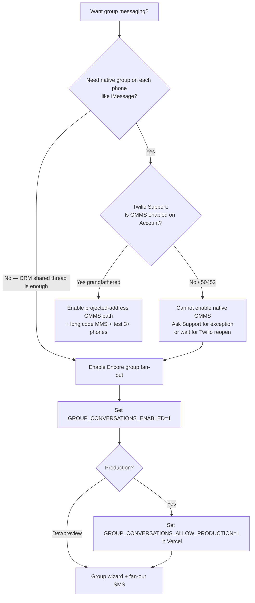

# Twilio Group Messaging Audit (Encore)

**Date:** 2026-07-23  
**Scope:** Native **Group MMS (GMMS)** vs Encore **group conversations** — how to enable what Twilio still allows.  
**Out of scope:** Realtor Broadcast / Bulk Messaging (ignored for this audit).

---

## 1. Executive verdict

| Question | Answer |
|----------|--------|
| Is Twilio **native Group MMS** (iMessage-style group on the phone) generally available? | **No for most accounts.** Limited since **Mar 15, 2022** to accounts that already had GMMS. New accounts get error **50452**. |
| Is that “deprecated”? | Twilio calls it a **limitation / unavailable for new use**, not a clean “GA → deprecated” rename — in practice: **closed to new enablement**. Docs live under **Conversations (classic)**. |
| Can Encore still offer “group messaging”? | **Yes — as a CRM group thread** that fans out **1 SMS per participant** (current production-safe path). |
| Can we flip an env and get native phone groups tomorrow? | **Only if Twilio Support confirms GMMS is enabled on this Account.** Most US 10DLC setups **cannot**. |

---

## 2. Official Twilio documentation (audit)

### 2.1 Native Group MMS — status

| Source | What Twilio says |
|--------|------------------|
| [Limitation to Group MMS (Changelog, Mar 15, 2022)](https://www.twilio.com/en-us/changelog/limitation-to-group-mms) | Group MMS **limited to existing accounts** until further notice. Accounts that used GMMS **before** that date can continue. **New** attempts → service unavailable. |
| [Error 50452](https://www.twilio.com/docs/api/errors/50452) | **“Group MMS is not enabled for this Account.”** Solution: verify if GMMS is allowed for the Account (Support). |
| [Group Texting in Conversations (classic)](https://www.twilio.com/docs/conversations-classic/group-texting) | How GMMS *worked*: **Projected Address**, US/CA **+1 long codes only**, max **~10 participants**, not toll-free/short code. Docs marked **Conversations (classic)**. |
| [Conversations (classic) Limits](https://www.twilio.com/docs/conversations-classic/conversations-limits) | Conversation can have many chat participants; **non-chat (SMS) participants get a blast-type message** (not always a native phone group). Native Group MMS capped ~**10**. |
| Blog “Group Texting for Businesses” | Archived copies note the **same Mar 2022 limitation**. Live “group texting” marketing often points at classic docs / 404s for newer paths. |

**Industry context (Twilio + community):** Carrier migration to **A2P 10DLC** broke reliable Group MMS for application-to-person traffic. That is why Twilio froze new GMMS — not because Encore coded it wrong.

### 2.2 What Twilio still supports without GMMS

| Pattern | Twilio product | Phone UX | Encore fit |
|---------|----------------|----------|------------|
| **1:1 SMS** | Programmable Messaging `messages.create` | Normal SMS thread | Conversations 1:1 (live) |
| **1:many fan-out** | Same API, loop `to` | Each person gets a **separate** SMS from the business number | **Current group send** in `api/index.ts` |
| **Multi-party Conversations (non-GMMS)** | Conversations API with **ProxyAddress** per SMS participant (no ProjectedAddress GMMS) | Still **not** one shared MMS group on device | Possible future; more Twilio Conversations SIDs |
| **Native Group MMS** | Projected Address + GMMS permission | True group on phone | **Blocked** unless Account is grandfathered |

### 2.3 Docs that are easy to misread

| Doc | Risk |
|-----|------|
| Classic “Group Texting” guide | Reads as if GMMS is on — **must** cross-check changelog + 50452 |
| Conversations GA marketing | “Group” often means **multi-participant Conversation**, not carrier MMS group |
| `OtherRecipients0..N` on inbound webhooks | Only present when carriers actually deliver **Group MMS**; 10DLC often sends **individual** SMS instead |

---

## 3. How this maps to Encore (this chat / product)

From prior work in this thread:

1. Users expected **iMessage-style** groups (one thread on every phone).  
2. Twilio/10DLC delivered **separate SMS** → GHL also showed individuals.  
3. Encore implemented **CRM group threads** + fan-out send + inbound merge.  
4. Prod gated off with env until native GMMS is realistic.

### Current code behavior (important)

Outbound group send **intentionally does not** call multi-`to` Group MMS:

```text
// api/index.ts — group send path
// 10DLC routes do not reliably deliver Group MMS to all `to` recipients
// → send one SMS per person
```

So even if UI “group” is enabled, phones still receive **1:1 SMS** unless Twilio GMMS is actually enabled **and** carriers honor it.

### Env gates (ops only)

| Variable | Role |
|----------|------|
| `GROUP_CONVERSATIONS_ENABLED` | Master switch (`0` = off everywhere). Local `.env` currently **`0`**. |
| `GROUP_CONVERSATIONS_ALLOW_PRODUCTION` | Must be `1` for groups on `VERCEL_ENV=production` |

UI flag comes from `GET /api/admin/init` (no Settings “Bulk-style” owner toggle for GMMS).

Internal docs:

- `docs/GROUP_CONVERSATIONS.md`  
- `docs/GROUP_CONVERSATIONS_PROPOSAL.md`  
- `docs/DESIGN_SYSTEM.md` (Conversations / groups section)

---

## 4. How to *enable* group messaging (decision tree)



### Path A — Encore CRM groups (available now)

**What users get**

- One **group thread in Encore**  
- Outbound: SMS to each member from business line  
- Inbound: replies merged into that group when routing matches  

**What users do *not* get**

- Single shared group bubble on every participant’s phone  
- Carrier “Group message” header  

**Enable**

1. Vercel / `.env`: `GROUP_CONVERSATIONS_ENABLED=1`  
2. Production only if also: `GROUP_CONVERSATIONS_ALLOW_PRODUCTION=1`  
3. Redeploy  
4. Smoke: `npm run validate:group-conversations`  
5. Manual: create group → send → confirm each phone gets SMS → reply merges in Encore  

### Path B — Native Twilio Group MMS (usually blocked)

**Twilio requirements (classic docs)**

- Account **allowed** for GMMS (pre–Mar 2022 or Support exception)  
- US/CA **+1 long code**, MMS-capable (not toll-free/short code for GMMS)  
- Conversations (classic) **Projected Address** model  
- ≤ ~10 participants  

**Enable steps (only after Support confirms)**

1. Open Twilio Support ticket: “Request confirmation whether Group MMS / GMMS is enabled for Account SID `ACxxxx`. We receive / expect 50452?”  
2. If enabled: follow [Group Texting in Conversations (classic)](https://www.twilio.com/docs/conversations-classic/group-texting)  
3. Change Encore outbound from fan-out loop → true multi-recipient / Conversations projected-address API  
4. Verify inbound webhooks include `OtherRecipients0..N`  
5. Only then treat “native group” as supported in UI copy  

**If Support says no:** do **not** promise iMessage-like groups; keep Path A only.

### Path C — Alternatives if native SMS group is mandatory

| Option | Notes |
|--------|--------|
| WhatsApp Business groups | Different product / opt-in; not drop-in for realtor SMS |
| RCS group (future) | Carrier-dependent; not a Twilio GMMS replacement today |
| Ask participants to create phone group including Twilio number | Inbound may sync if `OtherRecipients` present — fragile on 10DLC |

---

## 5. Recommended stance for Encore

1. **Treat Twilio native Group MMS as unavailable** until Support writes otherwise.  
2. **Product language:** “Group conversation” = **shared CRM thread + individual SMS**, not “phone group chat.”  
3. **Keep prod gate** (`ALLOW_PRODUCTION`) until stakeholders accept Path A UX.  
4. **Do not** invest in Broadcast for this problem (out of scope).  
5. Optional: Support ticket once to get a written GMMS yes/no for the live Account SID.

---

## 6. Checklist — enable Path A (CRM groups) safely

- [ ] Confirm stakeholders accept fan-out (not native phone group)  
- [ ] Set `GROUP_CONVERSATIONS_ENABLED=1`  
- [ ] If prod: `GROUP_CONVERSATIONS_ALLOW_PRODUCTION=1`  
- [ ] Deploy API + client  
- [ ] `npm run validate:group-conversations`  
- [ ] `npm run validate:direct-conversations` (no 1:1 break)  
- [ ] Test 3 real phones; confirm GHL/Twilio logs show **per-recipient** Message SIDs (expected)  
- [ ] Do **not** set copy that says “iMessage group” unless Path B is confirmed  

---

## 7. Reference links (Twilio)

| Topic | URL |
|-------|-----|
| GMMS limitation changelog | https://www.twilio.com/en-us/changelog/limitation-to-group-mms |
| Error 50452 | https://www.twilio.com/docs/api/errors/50452 |
| Group Texting (classic) | https://www.twilio.com/docs/conversations-classic/group-texting |
| Conversations classic limits | https://www.twilio.com/docs/conversations-classic/conversations-limits |
| Programmable Messaging (1:1 / fan-out) | https://www.twilio.com/docs/messaging |

---

*Broadcast / Bulk Messaging intentionally omitted from this audit.*
